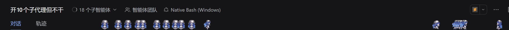
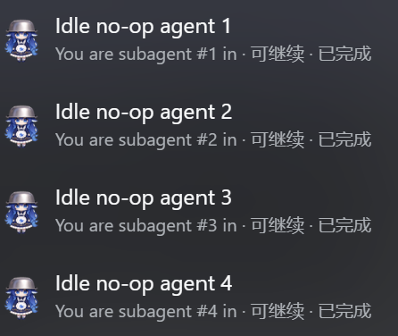

<!-- ═══════════════════════════════════════════════════════════════════════ -->

<div align="center">

#  dsh-ohjingjing-team 

### Replacing the Agent Team panel's member-row status icons with "ohjingjing" whales, drawing whales that run and stop in the session header, and swapping the green dots in the subagent dropdown for them too

**Three independently switchable components**: the member-row skin and the subagent list are pure CSS; the header runway reads the roster and the session status and builds its own track to the right of the official tab row

[](https://github.com/deepseek-ai/deepseek-harness)
[](https://dsh-plugin.org/plugins/spookywaste/dsh-ohjingjing-team)
[](https://www.npmjs.com/package/dsh-ohjingjing-team)

[**中文**](README.md) &nbsp;·&nbsp; **English**

</div>

---

## 🐳 What is this

~~Building an ohjingjing team~~ Replacing the DSH Agent Team panel's member-row status icons with "ohjingjing" whales.

<p align="center">
  <br>
  <sub>An ohjingjing team</sub>
</p>

## 🛝 The header runway

The empty strip to the right of the header's "Dialogue / Trace" tabs becomes a **shared track**: the lead session and its subagents show up here to run<del><sub>and to freeload</sub></del>.

<p align="center">
  <br>
  <sub>Lots of ohjingjing running</sub>
</p>

## 🟢 The subagent list

Every row of the "N subagents ▾" dropdown gets a whale where its status dot used to be:

<p align="center">
  <br>
  <sub>The dropdown: whales where the dots were, with row height and text layout unchanged</sub>
</p>

## 🎬 Running

A running ohjingjing has 4 animations:
<p align="center">
        <br>
 <sub>Previews of the four running modes</sub>
</p>

## 🎯 Standing still

The icon slot on the left of each member row in the Team panel (the "Agent Team" popover in the session header):


<p align="center">
  <br>
  <sub>Previews of the four non-running states: idle / handstand / warning / done — the last two are task-dot art and do not apply to member rows in this version</sub>
</p>

## 📦 Install
### CLI
```sh
dsh plugin --profile web add dsh-ohjingjing-team          
```
### Web / desktop plugin manager
On the plugin manager page, click "Add plugin" in the top right → enter the plugin name `dsh-ohjingjing-team` or the repository name
```sh
https://github.com/SpookyWaste/dsh-ohjingjing-team
```
Refresh the Web GUI and open the Team panel once. The header runway appears on its own in the session header; no extra switch is needed.

**One row per switch in the plugin manager**, all on by default, each switchable on its own; every row shows its own name and one-line description:

| Component | Entry name | What it does |
|---|---|---|
| Agent Team skin | `dsh-ohjingjing-team/skin` | member-row icons become ohjingjing |
| Header runway | `dsh-ohjingjing-team/runners` | the runway to the right of the header tab row |
| Subagent list | `dsh-ohjingjing-team/catalog` | the dots in the "N subagents" dropdown rows |
| The package itself | `dsh-ohjingjing-team` | the stylesheets and the runway runtime shared by the three |

#### Dependencies
| Item | Value |
|---|---|
| DSH | `≥0.2.0-rc.2` |
| Official Agent Team component<sub>@deepseek-ai/dsh-experimental-agent-team-profile</sub> | needed by component 1 only; keep it enabled |


## 🎛 Tunables

Appearance lives in custom properties on `:root`; overriding them needs no rebuild (user styles or browser overrides work):

| Variable | Default | Meaning |
|---|---|---|
| `--oj-max-size` | `40px` | **Skin** size bound, so the icon cannot run away at extreme font sizes. |
| `--oj-runner-size` | `26px` | **Runway** whale edge (at 26px the feet rest on that separator line). |
| `--oj-runners-gap` | `26px` | **Runway** slot spacing on first appearance (a full roster narrows it to fit the track). |
| `--oj-lap-duration` | `60.2s` | **Runway** duration of one lap (60.2s = 86 walk cycles, so footfalls stay in phase with the sprite; a longer or shorter lap scales the ground speed). |
| `--oj-max-subagents` | `20` | How many **subagents** the runway draws at most, beyond the lead (DSH keeps finished subagents in its totals, so the newest ones win). |
| `--oj-catalog-size` | `26px` | **Subagent list** icon-slot edge (the official slot is 14×17; enlarging it shifts the row text 12px right without changing row height). |
| `--oj-duration` | `0.7s` | **One walk cycle**, shared by the three components; animations with more steps scale up automatically. |

## 📜 Versions

<details>
<summary>Version history (click to expand)</summary>

- **0.4.1** — the runway became **one shared track**: the lead is always on it, followed by the newest 20 subagents; a finished lap respawns at the start with no offset, stopping happens in place, and a script cycles through the actions; a new **subagent list** component swaps the dropdown dots for whales; `--oj-cruise-scale` and `--oj-min-segment` were replaced by `--oj-lap-duration`.
- **0.4.0** — adds the **header runway** component: subagents are drawn to the right of the session header's tab row, each with the same mode as its member-row position and with displacement reversing together with the turn; the two components are switchable separately.
- **0.3.0** — running went from one seven-frame run to **four** animations.
- **0.2.2** — fixes **bleed between neighbouring frames** at the frame edges.
- **0.2.1** — fixes the running animation **skipping a frame**: the time axis and the position axis were written on one scale, so the last frame had a zero-length time window.
- **0.2.0** — the failure state becomes a **handstand**; the running state goes from two-frame ping-pong to a **seven-frame loop**.
- **0.1.2** — fixes the cropped failure-state artwork.
- **0.1.1** — fixes blurry icons on high-DPI screens and `error` falling back to `idle`; default icon edge 28px → 31px (using the full two-line text height, member card stays 51px).
- **0.1.0** — first release.

</details>

## 🙏 Artwork credit and license

"Ohjingjing" is the name the community uses; the character's real name is "Shenshen", and the design is licensed CC BY-NC-SA.
- Original whale-girl character design by [ZipZipPipe](https://space.bilibili.com/4168597).
- The "ohjingjing" (Shenshen) design by [这个刀子真甜](https://space.bilibili.com/23315338).
- This repository's code is MIT (see [LICENSE](LICENSE)).

<!-- ═══════════════════════════════════════════════════════════════════════ -->