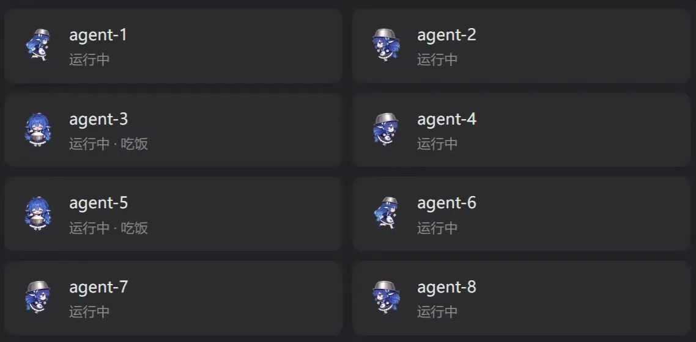

<!-- ═══════════════════════════════════════════════════════════════════════ -->

<div align="center">

#  dsh-ohjingjing-team 

### 用「哦鲸鲸」替换 DSH 智能体团队面板里成员行的状态图标

**一层纯 CSS 皮肤**：不注册槽位、不读远端数据、不改任何官方组件

[](https://github.com/deepseek-ai/deepseek-harness)


**中文** &nbsp;·&nbsp; [**English**](README.en.md)

</div>

---

## 🐳 这是什么

~~创建哦鲸鲸团队~~，用「哦鲸鲸」替换 DSH 智能体团队面板里成员行的状态图标。

<p align="center">
  <br>
  <sub>哦鲸鲸团队</sub>
</p>

## 🎬 运行中

运行中的哦鲸鲸有4种动画：
<p align="center">
        <br>
 <sub>四个运行状态的预览</sub>
</p>

## 🎯 静止中

团队面板（会话页头「智能体团队」浮层）成员行左侧的图标位：


<p align="center">
  <br>
  <sub>四个非运行状态的预览：静止 / 倒立 / 待命 / 完成——后两个是任务圆点的料，目前版本对成员行不生效</sub>
</p>

## 📦 安装
### CLI 安装
```sh
dsh plugin --profile web add dsh-ohjingjing-team          
```
### 网页版/桌面版插件管理安装：插件管理页面，右上角「添加插件」→ 填入插件名 `dsh-ohjingjing-team` 或仓库名
```sh
dsh plugin --profile web add ./dsh-ohjingjing-team-0.3.0.tgz
```
装完刷新 Web GUI，打开一次团队面板即可看到效果。

| 项 | 值 |
|---|---|
| 官方智能体团队组件<sub>@deepseek-ai/dsh-experimental-agent-team-profile</sub> | 保持开启 |
| DSH | `≥0.2.0-rc.2` |

## 🎛 可调参数

外观参数是 `:root` 上的自定义属性，改它们不需要重新构建（写进用户样式或浏览器覆盖即可）：

| 变量 | 默认 | 说明 |
|---|---|---|
| `--oj-max-size` | `40px` | 尺寸上限，防止在极端字号下图标失控。 |
| `--oj-duration` | `0.7s` | **一圈**的时长，步数多的玩法自动按比例拉长。 |

## 📜 版本

<details>
<summary>版本历史（点击展开）</summary>

- **0.3.0** —— 运行中从「一套七帧跑动」变成**四种**动画。
- **0.2.2** —— 修复帧边缘的**邻帧残留**。
- **0.2.1** —— 修复跑动动画**少播一帧**：关键帧的时间刻度与位置刻度被写成同一套，导致最后一帧的时间区间长度为零。
- **0.2.0** —— 失败态换成**倒立**姿态；运行态从两帧往返改为**七帧循环**。
- **0.1.2** —— 修复失败态素材被裁。
- **0.1.1** —— 修复高 DPI 屏图标发糊，并修复 `error` 状态回落为 `idle`；图标边长默认 28px → 31px（用满两行文字高度，成员卡仍为 51px）。
- **0.1.0** —— 首个版本。

</details>

## 🙏 素材来源与许可

「哦鲸鲸」（ohjingjing）为社区常用名，本名「深深」，形象为 CC BY-NC-SA 授权
- 原鲸鱼娘人设[ZipZipPipe](https://space.bilibili.com/4168597)。 
- 「哦鲸鲸」（深深）形象[这个刀子真甜](https://space.bilibili.com/23315338)。 
- 本仓库代码以 MIT 授权（见 [LICENSE](LICENSE)）。

<!-- ═══════════════════════════════════════════════════════════════════════ -->
